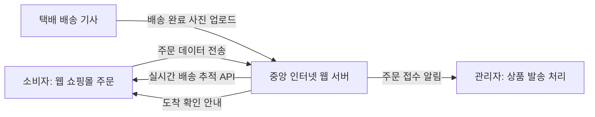
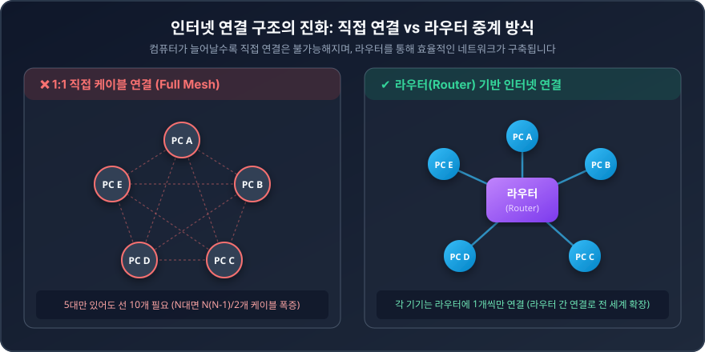
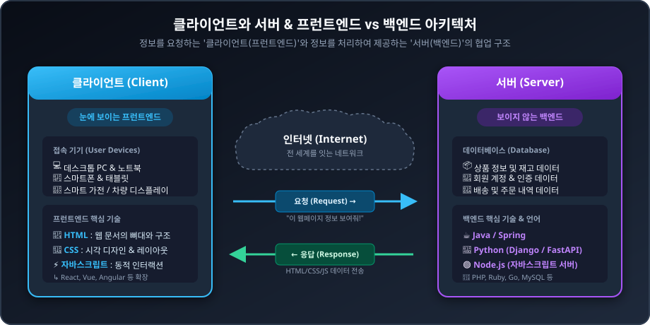
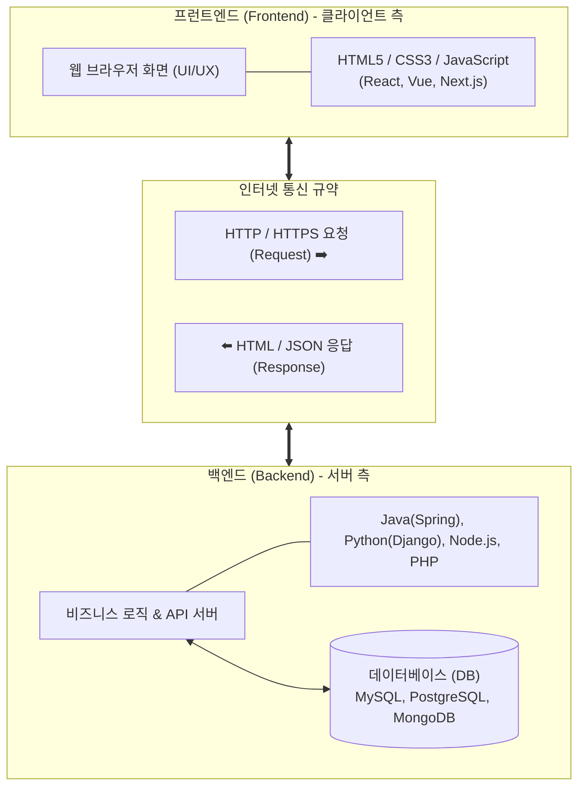
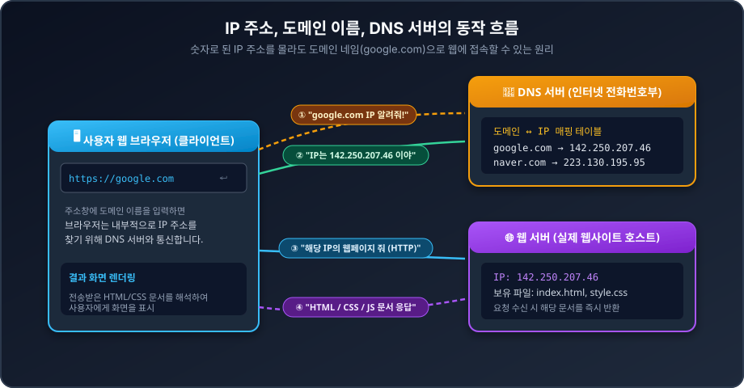
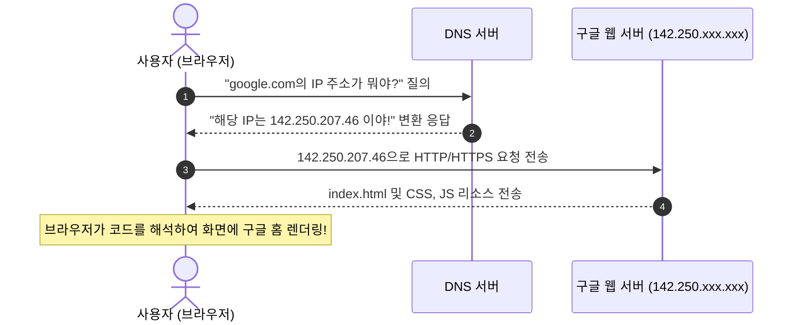
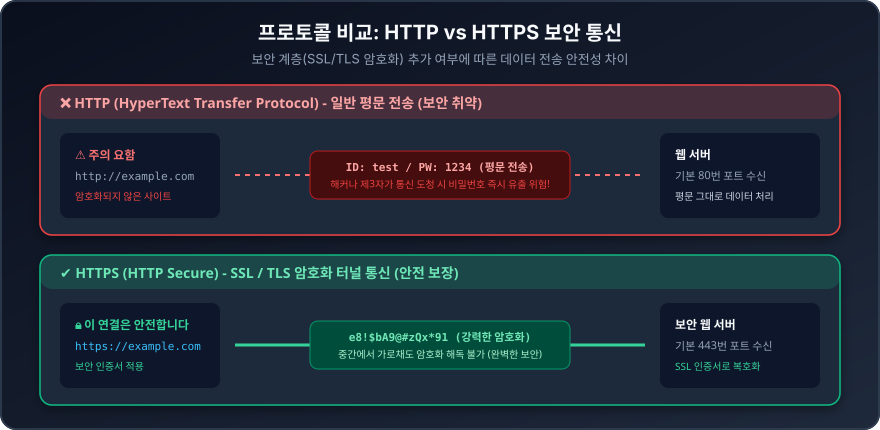
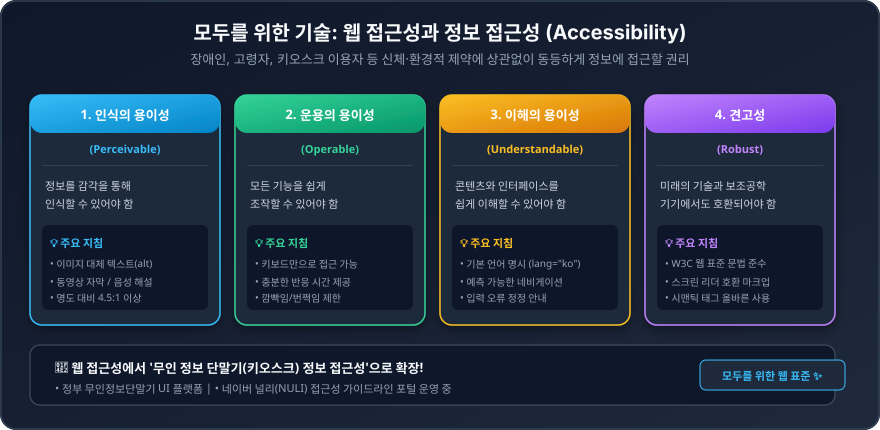

# 01 웹은 어떻게 움직일까 | Do it! HTML+CSS+자바스크립트 웹 표준의 정석 - 전면 개정판

> **강좌 정보**
> - **강의 영상**: [YouTube 바로가기](https://youtu.be/541YVNPbOso?si=62ReIbV0PGibnH4q)
> - **강의 채널**: 이지스퍼블리싱 (저자 직강)
> - **대상 교재**: 《Do it! HTML+CSS+자바스크립트 웹 표준의 정석 - 전면 개정판》
> - **동영상 재생시간**: 15분 20초 (920초)
> - **연계 실습 폴더**: `02/`

---

## 📌 한눈에 보는 핵심 요약 (Key Takeaways)

| 핵심 주제 | 핵심 요약 및 개념 |
| :--- | :--- |
| **웹 플랫폼의 진화** | 단순 텍스트/정보 전달 페이지에서 복잡한 애플리케이션처럼 작동하는 **웹 앱(Web App)**으로 발전 |
| **인터넷 연결 구조** | 컴퓨터 간 직접 1:1 연결은 불가능하므로, 중간에서 길을 찾아주는 **라우터(Router)**를 통해 전 세계 네트워크 구축 |
| **클라이언트 vs 서버** | 정보를 요청하는 사용자 단말(**클라이언트/프런트엔드**)과 데이터를 가공해 제공하는 호스트(**서버/백엔드**) |
| **IP, 도메인, DNS** | 숫자 주소(**IP 주소**) ↔ 기억하기 쉬운 문자 이름(**도메인**)을 변환해 주는 인터넷 전화번호부(**DNS 서버**) |
| **HTTP vs HTTPS** | 평문 데이터 전송 규약(**HTTP**)에 SSL/TLS 암호화 보안을 적용하여 개인정보를 안전하게 지키는 프로토콜(**HTTPS**) |
| **웹 & 정보 접근성** | 장애인, 고령자, 키오스크 이용자 등 신체·환경적 제약에 상관없이 누구나 동등하게 이용할 수 있도록 제작하는 표준 |

---

## 1. 웹의 발전과 '웹 플랫폼(Web Platform)'의 등장

### 1.1 단순 정보 제공에서 '웹 앱(Web App)'으로의 진화
- **초기 웹**: 하이퍼링크를 클릭하여 다른 문서로 이동하고 텍스트/이미지 등 정보를 단순히 읽는 단방향 정보 제공 중심이었습니다.
- **현대 웹**: 단순 문서 열람을 넘어 마치 PC나 스마트폰의 설치형 애플리케이션처럼 실시간으로 데이터를 주고받고 반응하는 **웹 애플리케이션(Web Application, 웹 앱)** 형태로 동작합니다.
  - 예: 온라인 문서 도구(구글 닥스, 노션), 클라우드 기반 피그마(Figma), 예매/결제 시스템, 실시간 대화형 서비스 등.

### 1.2 접속 기기의 다변화
과거에는 웹 접속 수단이 데스크톱 PC에 국한되었으나, 현재는 다양한 디바이스 환경이 웹에 접속합니다:
- 데스크톱 PC 및 노트북
- 스마트폰 및 태블릿
- 스마트 TV 및 스마트 가전(냉장고 디스플레이 등)
- 커넥티드 카(자율주행차 및 차량 인포테인먼트 시스템)

### 1.3 모든 서비스의 출발점: 웹 플랫폼 (Web Platform)
'플랫폼(Platform)'이란 본래 기차가 도착하고 떠나는 승강장(역)을 의미합니다. 현대 인터넷 사회에서는 **모든 비즈니스와 서비스의 출발점이자 중심 기지가 바로 웹(Web)**이 되었습니다.

- **쇼핑몰의 일상 예시**:
  1. 소비자가 스마트폰 웹 브라우저로 쇼핑몰에서 상품을 주문합니다.
  2. 주문 정보가 인터넷 상의 중앙 서버로 전송됩니다.
  3. 관리자가 웹 기반 백오피스에서 주문을 확인하고 상품을 출고합니다.
  4. 소비자는 웹을 통해 실시간 택배 이동 경로와 도착 예정 시간을 확인합니다.
  5. 배송 기사님이 배송 완료 후 현장 사진을 촬영하여 서버로 업로드하면, 고객과 관리자 모두 웹을 통해 즉시 확인합니다.
- **디지털 트랜스포메이션(Digital Transformation)**: 코로나19(COVID-19) 시기를 거치며 오프라인에 머물던 수많은 서비스와 행정이 전면 온라인/웹으로 이동하였습니다.

### 1.4 웹 표준(Web Standards)의 3대 기술
모든 기기와 모든 브라우저 환경에서 동일하게 동작하는 웹을 구축하기 위해 전 세계 공통 표준 규약이 필요합니다.

| 기술 | 역할 | 비유 | 주요 특징 |
| :---: | :---: | :---: | :--- |
| **HTML** | 구조 (Structure) | 건물의 뼈대와 벽돌 | 제목, 본문, 목록, 링크, 입력창 등 웹 문서의 기본 골격을 구성 |
| **CSS** | 표현 (Presentation) | 인테리어와 외관 디자인 | 색상, 폰트, 크기, 정렬, 반응형 레이아웃, 애니메이션 등 시각적 스타일링 |
| **자바스크립트 (JS)** | 동작 (Behavior) | 전기 배선과 스마트 제어장치 | 사용자의 클릭·입력 이벤트 처리, 비동기 데이터 통신, 동적 UI 제어 |

> 💡 **확장 기술 생태계**:
> - **프런트엔드 확장**: 순수 자바스크립트를 바탕으로 현대적인 대규모 웹 앱을 만들기 위한 라이브러리/프레임워크인 **React, Vue.js, Angular, Svelte** 등이 발전했습니다.
> - **백엔드 확장**: 브라우저 밖에서도 자바스크립트를 구동할 수 있는 런타임인 **Node.js**를 활용하여 백엔드 서버까지 개발할 수 있습니다.

---

## 2. 인터넷의 연결 구조와 네트워크 원리

인터넷(Internet)은 전 세계 수십억 대의 컴퓨터가 서로 정보를 주고받을 수 있도록 거대하게 연결된 **네트워크의 네트워크(Network of Networks)**입니다.

### 2.1 1:1 케이블 직접 연결 (Full Mesh)의 한계
두 대의 컴퓨터를 연결할 때는 하나의 랜선(케이블)만 있으면 충분합니다. 하지만 컴퓨터 수가 늘어나면 어떻게 될까요?

- 컴퓨터 $N$대를 모두 1:1로 직접 연결하려면 필요한 선의 수는 **$\frac{N(N-1)}{2}$** 개로 기하급수적으로 폭증합니다.
- 예: 컴퓨터 5대면 10개, 10대면 45개, 1,000대면 약 50만 개의 케이블과 포트가 필요하므로 현실적으로 구축이 불가능합니다.

### 2.2 해결사: 라우터(Router)를 통한 중계 방식
중간에 **라우터(Router)**라는 길잡이 중계 장치를 배치하면 문제가 완벽하게 해결됩니다.

- 각 컴퓨터는 중앙의 라우터에 단 1개의 선만 연결하면 됩니다.
- 라우터와 또 다른 라우터가 계층적으로 연결되면서 전 세계를 잇는 거대한 인터넷망이 형성됩니다.

### 2.3 지역적 거리를 초월하는 인터넷 통신
- **실제 사례**: 한국에 있는 학생이 자신의 PC에서 미국 NASA(미 항공우주국) 웹사이트에 접속하여 화성 탐사선 사진을 볼 수 있는 이유
  - 학생의 PC(한국) ↔ 로컬 라우터 ↔ 통신사(ISP) 망 ↔ 해저 광케이블 ↔ 미국의 라우터 ↔ NASA 웹 서버(미국)
  - 중간의 네트워크 라우터들이 초고속으로 최적의 경로를 찾아 데이터를 중계해주기 때문에 수천 킬로미터 떨어진 거리도 수십 밀리초(ms) 만에 연결됩니다.

---

## 3. 클라이언트와 서버, 프런트엔드 vs 백엔드

웹 통신의 기본 구조는 **요청(Request)**과 **응답(Response)**의 주고받음입니다.

### 3.1 클라이언트(Client)와 서버(Server)의 개념
- **클라이언트 (Client, 고객/요청자)**:
  - "이 웹페이지 내용 좀 보여줘!"라고 데이터를 요청하는 쪽.
  - 사용자가 사용하는 스마트폰, PC 브라우저, 태블릿 등이 해당합니다.
- **서버 (Server, 제공자/호스트)**:
  - "여기 요청한 HTML 문서와 데이터야!"라고 응답을 제공하는 쪽.
  - 24시간 꺼지지 않고 인터넷에 연결되어 대기하는 고성능 컴퓨터입니다.

### 3.2 프런트엔드 (Frontend) vs 백엔드 (Backend)

| 구분 | 프런트엔드 (Frontend) | 백엔드 (Backend) |
| :--- | :--- | :--- |
| **동작 위치** | 사용자 단말의 **웹 브라우저 (화면 앞단)** | 보이지 않는 **서버실 / 클라우드 인프라 (뒷단)** |
| **주요 역할** | • 사용자 인터페이스(UI) 및 경험(UX) 구현 • 레이아웃 디자인, 시각 효과, 애니메이션 • 사용자의 클릭/터치 입력 처리 | • 비즈니스 로직 연산 및 데이터 처리 • 회원 인증 및 보안 관리, 결제 처리 • 데이터베이스(DB) 저장 및 조회 |
| **핵심 언어/도구** | **HTML, CSS, JavaScript**, TypeScript (React, Vue, Angular, Svelte) | **Java**, **Python**, **JavaScript (Node.js)**, **PHP**, Go (Spring, Django, Express, MySQL, Redis) |
| **시각적 특징** | 눈에 직접 보이고 만져지는 시각적인 영역 | 화면 뒤에서 기계적으로 동작하는 비가시적 영역 |

---

## 4. 웹의 주소 체계: IP 주소, 도메인, DNS 서버

### 4.1 IP 주소 (IP Address)
- 인터넷에 연결된 모든 컴퓨터와 기기가 서로를 고유하게 식별하기 위해 부여받는 **인터넷상의 실제 숫자 주소**입니다.
- **IPv4**: `142.250.207.46` 처럼 4자리 숫자로 구성 (점 3개로 구분)
- **IPv6**: 기기 급증으로 주소가 고갈되자 16진수 8자리 형태로 확장된 규격

### 4.2 도메인 네임 (Domain Name)
- 복잡한 숫자 형태의 IP 주소를 일반 사용자가 일일이 외우는 것은 불가능합니다.
- 사람이 직관적으로 기억하고 입력하기 쉽도록 만든 문자 주소가 바로 **도메인(Domain)**입니다.
  - 예: `google.com`, `naver.com`, `daum.net`

### 4.3 DNS 서버 (Domain Name System Server)
- 사용자가 도메인 이름을 입력했을 때, 이를 컴퓨터가 이해하는 실제 IP 주소로 상호 변환해 주는 **"인터넷의 전화번호부 안내원"** 역할을 수행합니다.

### 4.4 주소창에 `google.com`을 입력했을 때 일어나는 4단계 여정

1. **도메인 질의**: 사용자가 웹 브라우저 주소창에 `google.com`을 입력하고 엔터를 누릅니다.
2. **IP 주소 조회**: 브라우저는 먼저 DNS 서버에 접속하여 `google.com`에 해당하는 IP 주소를 물어봅니다.
3. **IP 주소 획득**: DNS 서버가 `142.250.207.46`이라는 IP 주소를 찾아서 브라우저에 알려줍니다.
4. **웹 서버 접속 및 렌더링**: 브라우저는 해당 IP를 가진 웹 서버로 직접 찾아가 웹 문서를 요청하고, 받아온 HTML/CSS/JS를 해석하여 모니터 화면에 구글 페이지를 띄워줍니다.

---

## 5. 데이터 통신 규약: 프로토콜 (HTTP vs HTTPS)

### 5.1 프로토콜(Protocol)이란?
- 서로 다른 컴퓨터와 기기들이 대화하고 데이터를 주고받기 위해 약속한 **공통의 통신 규약(규칙)**입니다.
- 국가 간 외교관들이 만나 대화할 때 공식 의전 규범을 따르듯, 컴퓨터 통신에서도 정해진 형식과 순서에 맞추어 패킷을 전달해야 합니다.

### 5.2 HTTP (HyperText Transfer Protocol)
- 웹 브라우저(클라이언트)와 웹 서버가 웹 문서(HTML 등)를 주고받기 위해 사용하는 표준 규약입니다.
- **취약점**: 데이터가 **암호화되지 않은 일반 텍스트(Plain Text)** 형태로 전송됩니다.
- 카페 와이파이나 공공 네트워크 환경에서 악의적인 제3자(해커)가 통신 패킷을 훔쳐보면(스누핑/패킷 스니핑) 로그인 아이디, 비밀번호, 카드 정보 등이 그대로 노출될 위험이 큽니다.

### 5.3 HTTPS (HTTP Secure)
- 기존 HTTP에 **SSL(Secure Sockets Layer) 또는 TLS(Transport Layer Security)**라는 강력한 보안 암호화 계층을 추가한 프로토콜입니다.
- **안전성**: 클라이언트와 서버 간 전송되는 모든 데이터가 난수화되어 암호화 터널을 통과합니다.
- 해커가 중간에서 데이터를 가로채더라도 암호키가 없으면 외계어처럼 깨진 텍스트로 보여 해독이 불가능합니다.

### 5.4 웹 브라우저에서의 표시 차이

| 구분 | HTTP (`http://`) | HTTPS (`https://`) |
| :--- | :---: | :---: |
| **기본 포트** | 80번 포트 | 443번 포트 |
| **보안 자물쇠** | ❌ 없음 | 🔒 **자물쇠 아이콘 표시** |
| **크롬 경고 문구** | ⚠️ **"주의 요함" (Not Secure)** | ✅ **"이 연결은 안전합니다"** |
| **적용 권장 대상** | 테스트용 내부 서버 등 극히 일부 | **현대 모든 상용 웹사이트 필수 (로그인, 결제 등)** |

---

## 6. 모두를 위한 기술: 웹 접근성과 정보 접근성

웹 개발자가 기술적으로 기능만 구현하는 데 그치지 않고 반드시 준수해야 하는 사회적·윤리적 책임이 바로 **접근성(Accessibility)**입니다.

### 6.1 웹 접근성(Web Accessibility)의 정의
> "신체적 장애(시각, 청각, 지체 장애 등)를 가진 사람이나 고령자 등 정보 취약계층을 포함한 모든 사용자가 어떠한 환경에서도 동등하게 웹 사이트의 정보를 이해하고 이용할 수 있도록 보장하는 것"

### 6.2 무인 정보 단말기(키오스크)와 '정보 접근성'으로의 확장
- 코로나19 이후 음식점, 카페, 영화관, 병원, 관공서 등에 **무인 키오스크(무인 정보 단말기)**가 급증했습니다.
- 휠체어 이용자에게 화면 높이가 너무 높거나, 시각 장애인을 위한 음성 안내가 없거나, 고령자에게 글씨가 너무 작고 터치 반응 시간이 촉박하여 주문을 포기하는 이른바 **디지털 소외 현상**이 발생했습니다.
- 이에 따라 기존의 '웹 접근성' 개념이 **'무인 정보 단말기 UI 플랫폼'** 및 포괄적 **'정보 접근성'**으로 확장되었습니다.

### 6.3 웹 접근성 핵심 4대 원칙 (KWCAG 2.1 기준)

1. **인식의 용이성 (Perceivable)**: 모든 정보는 사용자의 감각(시각, 청각 등)으로 지각할 수 있어야 합니다.
   - 예: 시각 장애인을 위한 `` 태그의 `alt` 대체 텍스트 제공, 청각 장애인을 위한 동영상 자막 제공, 텍스트와 배경 간 명도 대비 4.5:1 이상 준수.
2. **운용의 용이성 (Operable)**: 마우스를 쥐기 힘든 사용자도 키보드(Tab 키, Enter 키)만으로 사이트의 모든 메뉴와 기능을 조작할 수 있어야 합니다.
   - 예: 키보드 초점(Focus) 이동 순서 보장, 시간제한이 있는 콘텐츠의 시간 연장 기능 제공.
3. **이해의 용이성 (Understandable)**: 콘텐츠의 내용과 인터페이스 동작 방식을 사용자가 쉽게 예측하고 이해할 수 있어야 합니다.
   - 예: HTML 문서 시작부에 언어 명시(`<html lang="ko">`), 일관된 네비게이션 구조, 양식 입력 오류 시 구체적인 수정 방법 안내.
4. **견고성 (Robust)**: 다양한 웹 브라우저, 보조공학 기기(화면 낭독 프로그램 스크린 리더 등) 및 미래의 소프트웨어 환경에서도 오류 없이 호환되어야 합니다.
   - 예: 마크업 오류(태그 중복, 열고 닫기 누락) 없는 웹 표준 문법 준수, 시맨틱 태그(`<header>`, `<nav>`, `<main>`, `<footer>` 등)의 올바른 활용.

### 6.4 실무 추천 웹 접근성 참고 사이트
- **정부 무인정보단말기 UI 플랫폼**: 국가 공공기관 및 민간 키오스크의 접근성 표준 가이드라인 제공
- **네이버 널리(NULI)** ([https://nuli.navercorp.com/](https://nuli.navercorp.com/)):
  - 네이버가 운영하는 대표적인 웹 접근성 전문 포털
  - 실무 마크업 지침, 스크린 리더 테스트 방법, 접근성 세미나 영상 및 오픈소스 가이드 제공

---

## 7. 동영상 강의 전체 타임라인 (Timestamps)

강의 영상의 주요 구간별 재생 타임스탬프입니다. 복습 시 필요한 부분을 바로 찾아볼 수 있습니다.

| 재생 시간 | 다루는 주제 | 강의 핵심 내용 |
| :---: | :--- | :--- |
| `00:01` | **강의 소개 및 오프닝** | 웹 개발 시작 전 알아두어야 할 필수 기초 개념과 용어 소개 |
| `00:30` | **웹의 진화와 웹 앱** | 단순 정보 전달에서 애플리케이션 형태(웹 앱)로 발전한 현대 웹 |
| `01:30` | **웹 플랫폼 (Web Platform)** | 모든 디지털 서비스의 출발점인 웹 플랫폼과 전자상거래 쇼핑몰 예시 |
| `02:40` | **디지털 트랜스포메이션 & 웹 표준** | 오프라인의 온라인 이전 현상과 HTML, CSS, JavaScript 웹 표준 3대 기술 |
| `04:30` | **인터넷의 연결 구조** | 컴퓨터 간 1:1 케이블 직접 연결의 비효율성과 한계점 분석 |
| `05:30` | **라우터(Router)의 등장** | 네트워크 구축 비용 절감 및 전 세계 네트워크를 이어주는 라우터의 원리 |
| `06:45` | **지역적 거리의 극복 사례** | 한국 학생 PC에서 미국 NASA 웹 서버로의 초고속 접속 예시 |
| `07:30` | **클라이언트와 서버** | 요청하는 쪽(클라이언트)과 제공하는 쪽(서버)의 정의 |
| `08:15` | **프런트엔드 vs 백엔드** | 화면 앞단(HTML/CSS/JS)과 서버 뒷단(DB/Java/Python)의 차이 |
| `09:20` | **IP 주소와 도메인 네임** | 컴퓨터 식별용 숫자 IP 주소와 사람이 기억하기 쉬운 도메인 이름 |
| `10:30` | **DNS 서버의 역할** | 도메인을 IP 주소로 상호 변환해 주는 인터넷 전화번호부 안내원 |
| `11:05` | **프로토콜의 정의 & HTTP** | 기기 간 대화 규칙인 프로토콜과 기본 웹 규약 HTTP |
| `12:05` | **보안 프로토콜 HTTPS** | 개인정보 보호를 위한 SSL 암호화 적용과 브라우저 자물쇠 표시 확인법 |
| `13:15` | **웹 접근성의 개념** | 나이, 장애에 상관없이 누구나 동등하게 사용할 수 있는 웹 환경 |
| `13:45` | **무인 단말기(키오스크) 정보 접근성** | 키오스크 확산에 따른 정보 접근성 확장과 정부/네이버 널리 참고 사이트 안내 |
| `15:05` | **강의 마무리 및 다음 시간 예고** | 웹 개발 기초 용어 정리 완료 및 다음 강좌(HTML 기초 실습) 안내 |

---

## 8. 자가 진단 복습 퀴즈 (Check Yourself)

<b>Q1. 컴퓨터 10대를 라우터 없이 1:1 직접 케이블로 모두 연결하려면 총 몇 개의 선이 필요할까요?</b>

**정답: 45개**  
- 공식: $\frac{N(N - 1)}{2} = \frac{10 \times 9}{2} = 45$개  
- 라우터를 사용하면 컴퓨터 10대가 라우터에 1개씩만 연결(총 10개)하면 되므로 네트워크 구축 비용과 복잡도를 획기적으로 줄일 수 있습니다.

<b>Q2. 웹 브라우저 주소창에 `google.com`을 입력했을 때, 이 도메인 이름을 실제 컴퓨터 숫자 주소인 IP 주소로 변환해 주는 서버는 무엇일까요?</b>

**정답: DNS 서버 (Domain Name System Server)**  
- DNS 서버는 인터넷의 전화번호부 역할을 수행하여 사람이 읽기 쉬운 문자 도메인을 컴퓨터가 통신할 수 있는 IP 주소로 매핑해 줍니다.

<b>Q3. HTTP와 비교했을 때 HTTPS를 사용해야 하는 가장 핵심적인 이유는 무엇일까요?</b>

**정답: 데이터 전송 시 SSL/TLS 보안 암호화가 적용되어 중간 도청이나 변조를 방지하기 때문**  
- HTTP는 평문으로 전송되어 아이디, 패스워드, 결제 정보 유출 위험이 있지만, HTTPS는 암호화 터널을 통해 안전하게 데이터를 전송합니다.

<b>Q4. 시각 장애인이 웹 페이지의 이미지를 스크린 리더로 이해할 수 있도록 HTML 코드에 반드시 작성해야 하는 속성은 무엇일까요?</b>

**정답: `alt` 속성 (대체 텍스트, Alternative Text)**  
- 예: ``  
- 이는 웹 접근성 4대 원칙 중 **'인식의 용이성'**을 준수하기 위한 필수 항목입니다.

