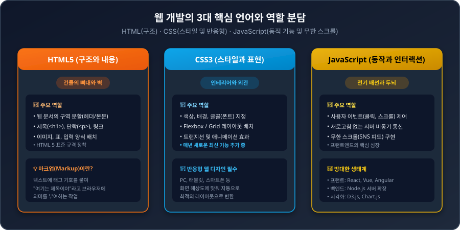
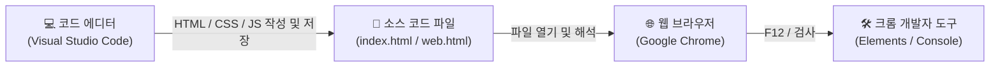
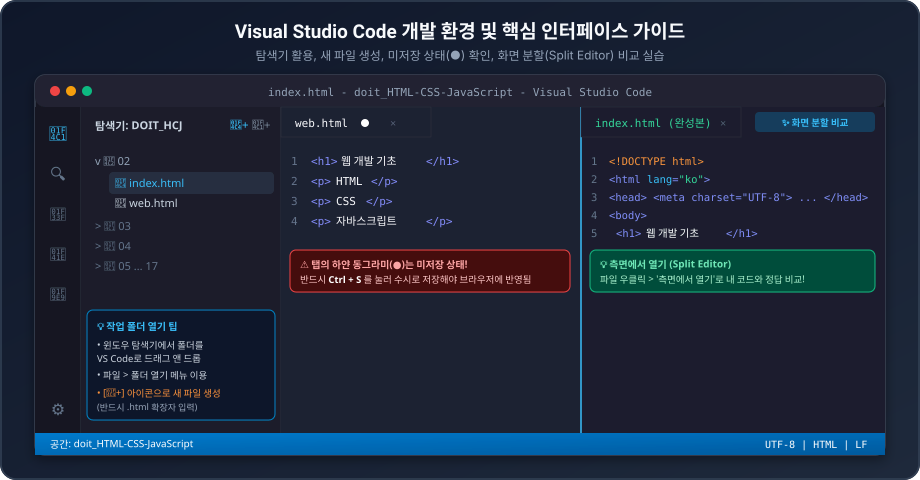
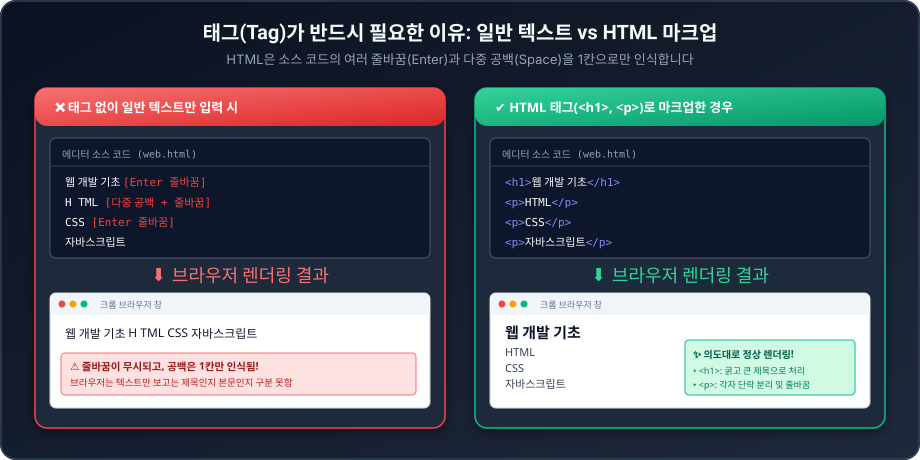
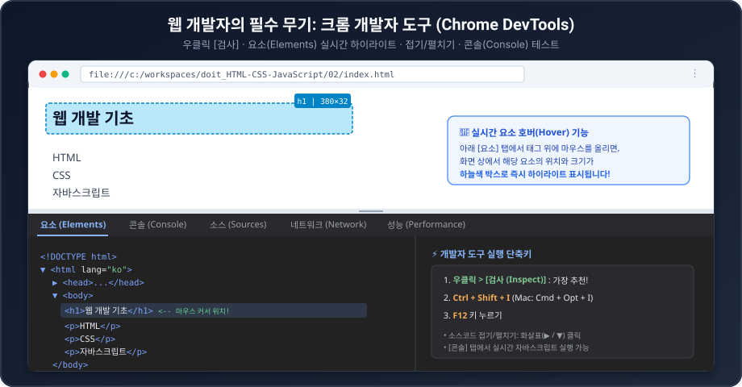

# 02 웹 개발 시작하기 | Do it! HTML+CSS+자바스크립트 웹 표준의 정석 - 전면 개정판

> **강좌 정보**
> - **강의 영상**: [YouTube 바로가기](https://youtu.be/8TQ8n-x7gMw?si=2BI3rzi42Wje6GG7)
> - **강의 채널**: 이지스퍼블리싱 (저자 고경희 직강)
> - **대상 교재**: 《Do it! HTML+CSS+자바스크립트 웹 표준의 정석 - 전면 개정판》
> - **동영상 재생시간**: 21분 10초 (1270초)
> - **연계 실습 폴더**: `02/` (`index.html`, `web.html`)

---

## 📌 한눈에 보는 핵심 요약 (Key Takeaways)

| 핵심 항목 | 강의 핵심 내용 및 실무 팁 |
| :--- | :--- |
| **웹 3대 언어의 역할** | **HTML**(문서 구조 및 내용) + **CSS**(스타일, 배치, 반응형 웹) + **자바스크립트**(동적 인터랙션, 무한 스크롤 등 프런트엔드의 핵심) |
| **필수 개발 도구 2가지** | **구글 크롬(Google Chrome)** 브라우저 + **비주얼 스튜디오 코드(VS Code)** 코드 에디터 |
| **VS Code 핵심 사용법** | • 작업 폴더를 에디터 창으로 드래그 앤 드롭<br>• 파일 탭 옆 하얀 동그라미(`●`)는 **미저장 상태** (`Ctrl + S` 저장 필수)<br>• **화면 분할(측면에서 열기)**을 통해 실습 코드와 완성본을 나란히 비교 |
| **태그(Tag)가 필요한 이유** | HTML은 엔터(줄바꿈)와 여러 번의 띄어쓰기(공백)를 **무조건 단 1개의 공백으로만 인식**하므로, 브라우저에 제목과 본문의 역할을 알려주기 위해 태그로 **마크업(Markup)**해야 함 |
| **크롬 개발자 도구 (DevTools)** | 브라우저 화면 우클릭 > **[검사 (Inspect)]** (`Ctrl + Shift + I`)<br>• 요소(Elements) 탭에서 태그 위에 마우스를 올리면 화면에 해당 영역이 실시간 하늘색 박스로 하이라이트 표시됨 |

---

## 1. 웹 개발 3대 언어의 명확한 역할 분담과 최신 웹 생태계

웹 개발은 크게 사용자 눈에 보이는 영역을 만드는 **프런트엔드(Frontend)**와 서버/데이터베이스를 다루는 **백엔드(Backend)**로 나뉩니다. 어떤 분야를 선택하든 웹 브라우저에 최종 결과물을 띄우기 위해서는 반드시 다음 3가지 언어를 기본으로 습득해야 합니다.



### 1.1 HTML5 (구조와 내용)
- 웹 문서의 뼈대와 레이아웃 구조를 만드는 마크업 언어입니다.
- "여기서부터 여기까지는 헤더(머리글), 이 부분은 제목, 실제 본문 내용은 여기서부터 여기까지"라고 컴퓨터와 브라우저에게 구획을 지정해 줍니다.
- HTML 4에서 HTML 5로 개정된 이후 현재는 표준 규격이 매우 안정적으로 자리 잡았습니다.

### 1.2 CSS3 (스타일과 표현)
- HTML로 만들어 둔 뼈대에 색상, 글꼴, 배경, 간격, 정렬 등 시각적인 스타일을 입히고 원하는 위치에 배치하는 언어입니다.
- **반응형 웹 디자인(Responsive Web Design)의 필수 도구**:
  - 오늘날 웹 사이트는 PC 모니터뿐만 아니라 스마트폰, 태블릿 등 화면 크기가 제각각인 수많은 기기에서 접속합니다.
  - 접속 기기의 화면 해상도에 맞춰 자동으로 최적화된 레이아웃을 보여주는 반응형 웹은 전적으로 CSS(미디어 쿼리, Flexbox, Grid 등)를 통해 구현됩니다.
- 웹 기술이 발전함에 따라 CSS는 매년 새로운 최신 기능과 문법이 지속적으로 추가되고 있습니다.

### 1.3 자바스크립트 (JavaScript - 동작과 인터랙션)
- 사용자의 클릭, 스크롤, 키 입력 등 모든 동작에 실시간으로 반응하고 웹 페이지를 살아 움직이게 만드는 프런트엔드의 두뇌이자 심장입니다.
- **동적 데이터 처리와 무한 스크롤(Infinite Scroll)**:
  - 인스타그램(Instagram)이나 페이스북(Facebook) 피드를 볼 때, 다음 페이지 버튼을 눌러 화면 전체가 새로고침되는 것이 아니라 스크롤을 내릴 때마다 서버에서 새로운 게시물을 비동기로 가져와 부드럽게 붙여줍니다.
  - 이처럼 페이지 전환 없이 실시간으로 데이터를 보여주는 모든 현대적 프런트엔드 테크닉의 중심에 자바스크립트가 있습니다.
- **프레임워크 생태계로의 확장**:
  - 순수 자바스크립트(Vanilla JS) 기초를 탄탄히 다진 후, 대규모 웹 애플리케이션 개발을 위한 **React, Vue.js, Angular** 등의 프런트엔드 프레임워크나 데이터 시각화 라이브러리(**D3.js**)로 확장할 수 있습니다.
  - 또한 **Node.js** 런타임을 통해 자바스크립트로 백엔드 서버까지 개발 영역을 확장할 수 있습니다.

### 1.4 추천 학습 도구: Git과 GitHub
- 웹 개발뿐만 아니라 모든 프로그래밍에서 내가 작성한 소스 코드의 수정 이력을 버전별로 기록하고 관리하는 **Git**과 원격 저장소 협업 플랫폼인 **GitHub**는 필수입니다.
- 본 교재의 기본 과정을 마친 후 반드시 Git과 GitHub를 추가로 학습하는 것을 강력히 추천합니다.

---

## 2. 웹 개발 준비물: 웹 브라우저 & 웹 편집기

웹 개발을 시작하기 위해 필요한 도구는 딱 2가지입니다.



1. **웹 브라우저**: 소스 코드를 해석하여 사용자 화면에 시각적으로 렌더링해 주는 프로그램
   - 크롬(Chrome), 엣지(Edge), 파이어폭스(Firefox), 사파리(Safari) 등이 있으나, 전 세계 점유율 1위이자 가장 강력하고 표준적인 웹 개발자 도구를 내장한 **구글 크롬(Google Chrome)**을 기준으로 실습합니다.
2. **웹 편집기 (코드 에디터)**: 소스 코드를 작성하고 관리하는 프로그램
   - 메모장으로도 코딩은 가능하지만, 코드 하이라이팅, 자동 완성, 디버깅, 확장 도구를 지원하는 전용 에디터가 필수적입니다.
   - 전 세계 개발자들이 가장 널리 사용하며 Windows, macOS, Linux를 모두 완벽 지원하는 마이크로소프트의 오픈소스 편집기인 **비주얼 스튜디오 코드(Visual Studio Code, VS Code)**를 사용합니다.

---

## 3. VS Code 핵심 활용법 완벽 가이드



### 3.1 VS Code 설치 및 한국어 언어팩 적용
1. 포털 사이트에서 `VS Code 다운로드`를 검색하거나 공식 홈페이지([https://code.visualstudio.com/](https://code.visualstudio.com/))에 접속합니다.
2. `Download for Windows` 버튼을 클릭하여 설치 파일을 내려받습니다.
3. 기본 옵션 그대로 `Next`를 계속 누르며 설치를 완료합니다.
4. VS Code를 처음 실행하면 우측 하단에 **"한글 언어팩(Korean Language Pack) 설치를 위해 재시작하시겠습니까?"**라는 알림 팝업이 뜹니다. 이를 클릭하면 자동으로 한국어 인터페이스로 패치됩니다.

### 3.2 작업 폴더(Workspace) 추가하는 2가지 방법
코딩을 시작하려면 내가 작업할 파일들이 모여 있는 폴더를 VS Code에 인식시켜야 합니다.

- **방법 1 (가장 편리한 방법 - 드래그 앤 드롭)**:
  - 윈도우 파일 탐색기를 열어 예제 실습 폴더(`doit_HTML-CSS-JavaScript`)를 찾습니다.
  - 해당 폴더를 마우스로 잡고 **VS Code 창 안으로 그대로 드래그 앤 드롭**하면 즉시 작업 영역으로 등록됩니다.
- **방법 2 (상단 메뉴 이용)**:
  - 상단 메뉴에서 `파일(File)` > `폴더 열기(Open Folder)`를 클릭한 후 실습 폴더를 선택합니다.
- **작업 폴더 닫기**: `파일` > `폴더 닫기`를 누르면 현재 작업 폴더 연결이 해제됩니다. 다른 프로젝트로 전환할 때 사용합니다.

### 3.3 탐색기 창 다루기와 새 파일 생성
- **폴더 트리 탐색**: 탐색기 창에서 폴더 앞의 화살표 꺾쇠(`>` 또는 `v`)를 클릭하면 하위 폴더와 파일 목록이 펼쳐지거나 접힙니다.
- **새 파일 만들기 (`web.html`)**:
  - 실습 대상 폴더인 `02` 폴더를 정확히 클릭하여 선택합니다.
  - 작업 폴더명 오른쪽에 나타나는 **새 파일 아이콘(`📄+`)**을 클릭하거나, `02` 폴더를 우클릭하고 **[새 파일]**을 선택합니다.
  - 파일명을 `web.html`로 입력합니다.  
    > ⚠️ **주의**: 웹 브라우저가 HTML 문서임을 인식할 수 있도록 반드시 뒤에 **`.html` 확장자**를 명시해야 합니다.

### 3.4 탭 관리와 화면 분할(Split Editor) 비교 팁
- **미저장 상태 확인 (매우 중요)**:
  - 코드를 한 글자라도 수정하면 상단 파일 탭 이름 옆에 **하얀 동그라미 점(`●`)**이 표시됩니다.
  - 이 점이 떠 있다면 아직 파일 저장이 안 된 상태이므로, 반드시 **`Ctrl + S`** (Mac: `Cmd + S`)를 눌러 수시로 저장해야 브라우저에 변경 사항이 반영됩니다.
- **마우스 휠 버튼으로 탭 닫기**: 닫고자 하는 탭 위에서 마우스 휠(가운데 버튼)을 클릭하면 `×` 버튼을 정확히 누르지 않아도 즉시 닫힙니다.
- **화면 분할(측면에서 열기)로 코드 비교하기**:
  - 내가 작성 중인 실습 코드(`web.html`)와 책에서 제공하는 완성 정답 코드(`index.html`)를 나란히 비교하며 공부할 수 있습니다.
  - 비교하고 싶은 파일을 우클릭하고 **[측면에서 열기(Open to the Side)]**를 선택하거나, 탭을 오른쪽 화면 끝으로 드래그하면 화면이 좌우 반반(50:50)으로 분할됩니다.

---

## 4. 태그(Tag)와 마크업(Markup)의 본질

### 4.1 직접 실습: 태그 없이 일반 텍스트만 작성해보기
새로 만든 `02/web.html` 파일에 태그 없이 다음과 같이 일반 텍스트로 4줄을 입력하고 저장(`Ctrl + S`)해 봅니다.

```text
웹 개발 기초
H       TML
CSS
자바스크립트
```

### 4.2 HTML의 공백 축약(Whitespace Collapse) 현상
작성한 `web.html`을 크롬 브라우저에서 열어보면 매우 당황스러운 결과를 마주하게 됩니다.



1. **줄바꿈(Enter) 무시**:
   - 에디터에서는 분명 4줄로 엔터를 쳐서 작성했으나, 브라우저 화면에는 **모든 글자가 단 1줄로 길게 이어져서 출력**됩니다.
2. **다중 공백(Space) 축약**:
   - `H`와 `TML` 사이에 스페이스바를 아무리 여러 번 눌러 공백을 많이 주어도, 브라우저는 오직 **단 1칸의 공백(Single Space)**으로만 축약하여 인식합니다.

> 💡 **이유**:  
> 웹 브라우저는 텍스트 문서의 줄바꿈이나 공백 문자를 그대로 신뢰하지 않도록 설계되었습니다. 브라우저에게 "이 부분은 제목이고, 여기서 줄을 바꾸어 다음 단락으로 넘어가라"는 구조적 명령을 내리려면 반드시 약속된 기호인 **태그(Tag)**를 사용해야 합니다.

### 4.3 태그(Tag) 적용과 마크업(Markup)의 의미
이제 소스 코드를 다음과 같이 태그를 감싸서 수정해 봅니다.

```html
<h1>웹 개발 기초</h1>
<p>HTML</p>
<p>CSS</p>
<p>자바스크립트</p>
```

- **`<h1>` 태그 (Heading 1)**: 가장 중요한 1단계 제목임을 선언합니다. 브라우저는 이를 크고 굵은 제목 글씨로 자동 렌더링하고 앞뒤로 여백을 부여합니다.
- **`<p>` 태그 (Paragraph)**: 하나의 문단 단락임을 선언합니다. 단락이 끝나는 지점마다 브라우저가 자동으로 줄을 바꾸어 줍니다.
- **시작 태그와 닫는 태그**:
  - 태그는 열림 태그(`<h1>`)로 영역의 시작을 알리고, 슬래시(`/`)가 들어간 닫는 태그(`</h1>`)로 영역의 끝을 지정합니다.
  - VS Code에서는 시작 태그를 열면 자동으로 닫는 태그를 완성해 주는 편리한 기능을 제공합니다.
- **마크업(Markup)이란?**:  
  웹 문서 안의 텍스트에 "여기는 제목, 여기는 본문 문단, 여기는 표나 이미지"라고 약속된 기호(태그)를 달아 표시하는 일련의 작업을 뜻합니다.

---

## 5. 웹 개발자의 필수 무기: 크롬 개발자 도구 (Chrome DevTools)

코드를 작성하고 브라우저에서 실행했을 때, 화면 뒤에서 HTML과 CSS가 어떻게 적용되고 있는지 분석하고 오류를 찾는 도구가 **웹 개발자 도구(DevTools)**입니다.



### 5.1 개발자 도구를 실행하는 3가지 방법
1. **마우스 우클릭 > [검사 (Inspect)] 선택 (★ 가장 빠르고 추천하는 실무 방법)**:
   - 확인하고 싶은 웹 페이지 요소 위에서 우클릭 후 `검사`를 누르면 개발자 도구가 열리면서 해당 태그 위치로 즉시 이동합니다.
2. **단축키 사용**:
   - Windows: **`Ctrl + Shift + I`** 또는 **`F12`**
   - Mac: **`Cmd + Option + I`**
3. **크롬 메뉴 버튼 이용**:
   - 우측 상단 더보기(`⋮`) > `도구 더보기` > `개발자 도구` 클릭

### 5.2 개발자 도구의 핵심 기능

#### ① 요소(Elements) 탭 & 실시간 마우스 호버(Hover) 효과
- 브라우저가 현재 화면을 구성하고 있는 HTML DOM 트리 구조를 그대로 보여줍니다.
- **실시간 화면 하이라이트**:
  - `Elements` 탭에서 마우스 커서를 `<h1>` 태그나 `<p>` 태그 위로 가져가면, 브라우저 상단 웹페이지 화면에서 **해당 태그가 차지하는 실제 크기와 위치가 하늘색 박스로 즉시 하이라이트**되어 표시됩니다.
  - 마진(Margin)은 주황색, 패딩(Padding)은 초록색 등 박스 모델 영역이 시각적으로 구분되어 레이아웃 디버깅에 결정적인 역할을 합니다.
- **코드 접기/펼치기 화살표(▶ / ▼)**:
  - 코드가 수백 줄로 길어지면 소스를 한눈에 보기 어렵습니다.
  - 태그 좌측의 작은 삼각형 화살표를 클릭하여 하위 태그들을 접거나 펼치며 집중할 수 있습니다.

#### ② 콘솔(Console) 탭
- 자바스크립트 실행 중 발생한 문법 오류나 에러 로그를 붉은색으로 출력해 줍니다.
- 콘솔 입력창에 자바스크립트 명령어를 직접 타이핑하여 즉시 실행 결과를 테스트해 볼 수 있는 인터랙티브 터미널 역할을 합니다.

#### ③ 스타일(Styles) 탭
- 선택한 HTML 요소에 현재 어떤 CSS 스타일(글자 크기, 색상, 마진 등)이 적용되어 있는지 보여줍니다.
- 값을 직접 더블 클릭하여 실시간으로 색상이나 크기를 바꾸어 보며 즉석에서 디자인을 테스트할 수 있습니다.

---

## 6. 동영상 강의 전체 타임라인 (Timestamps)

강의 영상의 주요 구간별 재생 타임스탬프입니다.

| 재생 시간 | 다루는 주제 | 강의 핵심 내용 |
| :---: | :--- | :--- |
| `00:00` | **강의 오프닝** | 웹 개발 시작을 위한 기본 언어 및 개발 환경 세팅 목표 소개 |
| `00:30` | **프런트엔드와 백엔드의 기본** | HTML, CSS, JavaScript 3대 기본 언어의 중요성 |
| `01:12` | **Git과 GitHub 추천** | 개발자 필수 역량인 버전 관리 시스템(VCS) 학습 추천 |
| `01:40` | **HTML의 역할** | 웹 문서의 뼈대와 레이아웃 구조를 만드는 역할 |
| `02:15` | **CSS와 반응형 웹** | 시각적 디자인, 요소 배치, 화면 기기별 반응형 웹 디자인 |
| `02:45` | **자바스크립트의 위력** | 프런트엔드의 핵심 심장, SNS 피드의 무한 스크롤(Infinite Scroll) 원리 |
| `03:50` | **웹 기술의 진화** | HTML5 표준 정착과 끊임없이 발전하는 최신 CSS/JS 생태계 |
| `04:45` | **웹 개발 준비물 2가지** | 웹 브라우저(크롬)와 웹 편집기(VS Code) |
| `05:50` | **VS Code 다운로드 & 설치** | 공식 사이트 다운로드 및 한국어 언어팩 설치 방법 |
| `07:15` | **VS Code 인터페이스 & 확장팩** | 5대 기본 아이콘과 다양한 확장 기능(Extensions) 소개 |
| `08:10` | **작업 폴더(Workspace) 열기** | 탐색기에서 실습 폴더를 VS Code로 드래그 앤 드롭하는 꿀팁 |
| `09:40` | **메뉴를 통한 폴더 열기** | `파일 > 폴더 열기` 메뉴 및 폴더 닫기 기능 |
| `10:20` | **탐색기 창 구조** | 폴더 트리 접기/펼치기, 파일 클릭하여 코드 열기 |
| `11:05` | **저장 상태 확인 (● 점)** | 파일 수정 시 나타나는 하얀 점과 `Ctrl + S` 저장 습관 |
| `11:40` | **마우스 휠 탭 닫기** | 편리한 에디터 탭 닫기 팁 |
| `12:10` | **화면 분할 (Split Editor)** | 연습 코드와 완성 코드를 양옆에 나란히 놓고 비교하기 |
| `13:10` | **새 파일 만들기 (`web.html`)** | `02` 폴더 선택 후 새 파일 생성 및 `.html` 확장자 필수 규칙 |
| `14:15` | **일반 텍스트 입력 실습** | 태그 없이 4줄 텍스트 입력 후 브라우저 열기 |
| `14:50` | **공백 축약(Whitespace Collapse)** | 줄바꿈이 무시되고 1줄로 출력되는 브라우저의 특성 확인 |
| `15:20` | **다중 공백 테스트** | 여러 칸의 띄어쓰기가 1칸으로 축약되는 현상 실습 |
| `16:00` | **태그(Tag) 적용하기** | `<h1>` 제목 태그와 `<p>` 단락 태그 감싸기 |
| `17:05` | **마크업 결과 브라우저 확인** | 제목과 단락으로 정상 분리되어 렌더링된 화면 확인 |
| `17:35` | **마크업(Markup)의 개념 정의** | 텍스트에 의미와 역할을 부여하는 약속된 기호 '태그' |
| `18:15` | **크롬 개발자 도구 실행법** | 우클릭 [검사] 메뉴, 단축키 `Ctrl + Shift + I` |
| `19:15` | **요소(Elements) 탭 실시간 호버** | 태그에 마우스 올렸을 때 브라우저 화면 영역 하이라이트 기능 |
| `20:10` | **소스 코드 접기/펼치기** | 긴 코드를 화살표로 정리하는 트리 토글 기법 |
| `20:45` | **강의 마무리 및 요약** | 3대 언어 복습, VS Code 환경 설정 완료 및 다음 강좌 예고 |

---

## 7. 자가 진단 복습 퀴즈 (Check Yourself)

<details>
<summary><b>Q1. VS Code에서 HTML 파일을 수정 중일 때, 상단 탭 파일 이름 옆에 하얀 동그라미(●)가 표시되어 있다면 이것은 무엇을 의미하며 어떻게 대처해야 할까요?</b></summary>
<div markdown="1">

**정답: 아직 파일이 디스크에 저장되지 않은 미저장 상태를 의미하며, `Ctrl + S`를 눌러 저장해야 합니다.**  
- 저장하지 않고 브라우저를 새로고침하면 수정한 코드가 반영되지 않으므로, 코드를 편집한 후 항상 동그라미가 `×` 표시로 바뀔 때까지 저장하는 습관이 필수적입니다.
</div>
</details>

<details>
<summary><b>Q2. HTML 문서 작성 시 엔터(Enter) 키로 5번 줄바꿈을 하고 스페이스바로 10칸을 띄워 작성했음에도 불구하고, 웹 브라우저에서는 줄바꿈이 무시되고 공백이 딱 1칸으로만 표시되는 현상을 무엇이라고 부르나요?</b></summary>
<div markdown="1">

**정답: 공백 축약 (Whitespace Collapse)**  
- HTML 렌더링 엔진은 태그 없는 연속된 공백 문자(스페이스, 탭, 줄바꿈)를 단 하나의 단일 공백으로 압축하여 처리합니다. 줄바꿈을 하려면 `<p>`나 `<br>` 같은 전용 HTML 태그를 사용해야 합니다.
</div>
</details>

<details>
<summary><b>Q3. 크롬 브라우저에서 특정 웹페이지 화면 요소의 HTML 코드 구조와 CSS 스타일을 즉시 분석하기 위해 개발자 도구를 실행하는 가장 빠른 마우스 조작 방법은 무엇일까요?</b></summary>
<div markdown="1">

**정답: 해당 화면 요소 위에서 마우스 우클릭 후 [검사 (Inspect)] 클릭**  
- 단축키로는 `Ctrl + Shift + I` (Mac: `Cmd + Option + I`) 또는 `F12` 키를 누르면 바로 개발자 도구가 열립니다.
</div>
</details>

<details>
<summary><b>Q4. VS Code에서 내가 실습 중인 코드 파일과 책에서 제공한 정답 완성본 코드를 좌우 화면으로 나란히 띄워 비교하며 코딩하고 싶을 때 사용하는 기능은 무엇인가요?</b></summary>
<div markdown="1">

**정답: 측면에서 열기 (화면 분할 / Split Editor)**  
- 파일 탭을 우클릭하고 '측면에서 열기'를 누르거나, 에디터 탭을 창 우측 가장자리로 드래그 앤 드롭하면 화면이 50:50으로 분할되어 두 코드를 동시에 대조할 수 있습니다.
</div>
</details>
